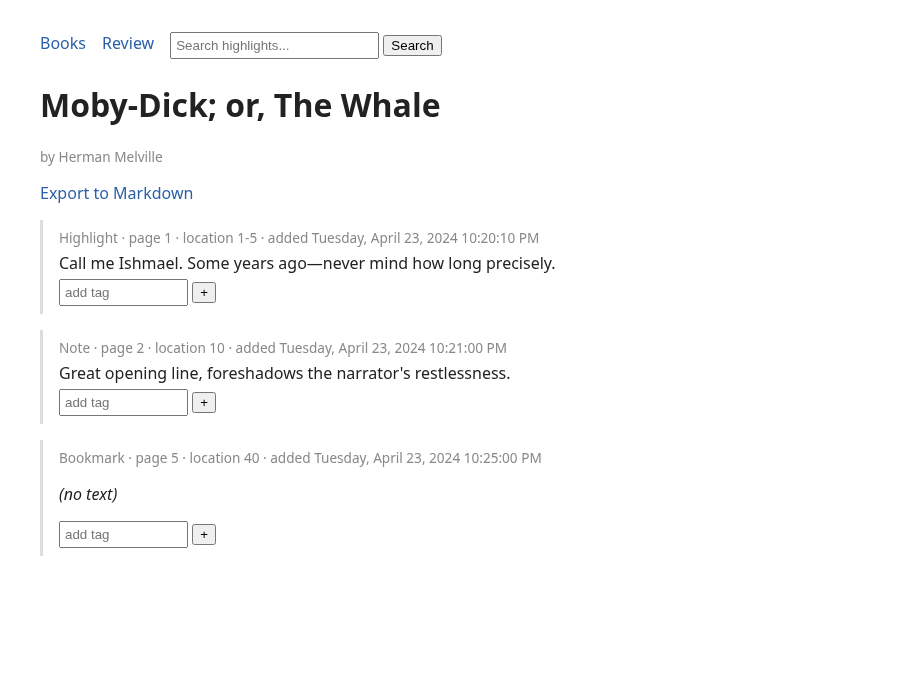

# Passagekeep

**Status: POC**

A local-first app that turns the `My Clippings.txt` file exported by e-readers
into a searchable, taggable highlights library, with a simple spaced-repetition
review queue and Markdown export.

Works with the `My Clippings.txt` file exported by Kindle e-readers (a factual
compatibility note only — this project is not affiliated with or endorsed by
Amazon).

## Why

Existing tools for this are scattered scripts, not a polished app. Passagekeep
is a small, local, single-user tool: parse the export, store it in SQLite,
browse/search/tag it from a local web UI, review highlights on a schedule,
and export a book's highlights as Obsidian-friendly Markdown.

## What works

- Robust parser for `My Clippings.txt`: highlights, notes, and bookmarks;
  handles UTF-8 BOM and CRLF line endings; English date formats; dedupes
  overlapping/edited highlights (e.g. when you extend a highlight on-device,
  the reader leaves the old entry in the file — Passagekeep keeps the
  newest/longest version instead of double-counting it).
- SQLite storage with full-text search (SQLite FTS5).
- Idempotent import: re-importing the same (or an overlapping) export file
  adds nothing new.
- Local web UI (FastAPI + HTMX): browse books, full-text search, tag
  highlights, a daily review queue (SM-2 spaced repetition), and
  Markdown export per book.
- CLI: `import`, `serve`, `export`.
- Automated tests: parser edge cases, import idempotency, export output,
  storage/review logic, and basic web routes.

## What doesn't work yet

- English-only date parsing (other locales are stored as raw text but not
  parsed into real dates).
- No authentication — this is meant to run on localhost for one person.
- No pagination on large libraries; the UI is intentionally simple for v0.1.
- No delete/undo UI yet for tags or imported highlights (edit the DB directly
  if needed).
- Single SQLite file, no multi-device sync.

## Install & run

Requires Python 3.10+. Using [`uv`](https://github.com/astral-sh/uv):

```bash
cd passagekeep
uv venv .venv
source .venv/bin/activate
uv pip install -e ".[dev]"

# Import a clippings file (creates ./passagekeep.db by default)
passagekeep import /path/to/My\ Clippings.txt

# Run the local web UI at http://127.0.0.1:8420
passagekeep serve

# Export a book's highlights to Markdown
passagekeep export "Pride and Prejudice" --format md
```

Or with `pipx`:

```bash
pipx install -e .
```

## CLI reference

```
passagekeep [--db PATH] import <file>
passagekeep [--db PATH] serve [--host HOST] [--port PORT]
passagekeep [--db PATH] export <book title> [--format md] [--output FILE]
```

`--db` defaults to `passagekeep.db` in the current directory.

## Running the tests

```bash
source .venv/bin/activate
pytest -q
```

## Design notes

- **Parser** (`src/passagekeep/parser.py`) is the core and is tested the
  hardest: see `tests/test_parser.py` and `tests/fixtures/`. All fixture
  data is invented or drawn from public-domain books (Moby-Dick, Pride and
  Prejudice, Sherlock Holmes) — no real personal data.
- **Dedup identity**: each clipping hashes to a `content_hash` derived from
  book + author + type + location + text (not import time), so the same
  content imported twice is a no-op at the storage layer. Overlapping
  highlights within a book are additionally merged by the parser before
  import (newest/longest wins).
- **Review**: a minimal SM-2 implementation (`Store.grade_review`), one
  state row per highlight, graded 0–5.
- **Export**: YAML frontmatter + one `##` section per highlight/note, tags
  as `#tag` — designed to drop straight into an Obsidian vault.

## Screenshot



## License

MIT — see [LICENSE](LICENSE).
